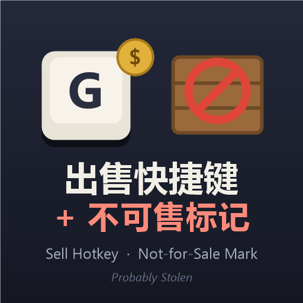

# 出售快捷键 + 不可售标记（SellGuard）

《深空当铺：可能是偷的》（Probably Stolen）的 mod。

- Steam 创意工坊：<https://steamcommunity.com/sharedfiles/filedetails/?id=3838227977>
- 适配游戏版本：0.46D



## 功能

**1. 出售快捷键**

在游戏的「设置 → 按键」里新增一项「出售（确认交易）」，默认 `G`，可以改键。
客户来买东西时按下，等同于点击谈判平板上的「出售」按钮，原版的预算、交易锁定等检查照常生效。
客户预算不足时，会先打开平板，显示原版的「预算不足，仍要卖吗」确认框。

**2. 不可售标记**

物品右键菜单最后一行新增「标记为不可售 / 取消不可售标记」（只能标记自己拥有的物品）。

- 被标记的物品即使摆上台面，客户也不会买，单件出售和「全部出售」都会跳过它。
- 装着标记物品的容器也整件卖不出去。
- 谈判平板上显示为「不可售」，悬停提示里有红字说明。

典型用法：把机器的出料口、自己要留的工具标记掉，一键出售时就不会被顺手卖掉。

## 安装

- 订阅创意工坊物品；或者
- 手动安装：把 `manifest.xml`、`SellGuard.dll`、`preview.png` 放进 `Probably Stolen\Mods\SellGuard\`。

本地 `Mods` 文件夹里同 ID 的副本会优先于创意工坊版本加载。

## 存档说明

标记以自定义 tag `SELL_GUARD_NOT_FOR_SALE_TAG` 保存在物品上，随存档保存。
卸载本 mod 后标记不再生效，对原版没有影响。
没有复用原版的 `NOT_FOR_RESALE`：那是原版的物品类型标签，部分任务物品原生就带，用独立 tag 可以避免取消标记时误删原生属性。

## 实现

全部用 Harmony 补丁，不需要任何额外权限（manifest 的 `Capabilities` 为空，已用游戏自带的 mod 扫描器检查过）。

| 文件 | 内容 |
|---|---|
| `SellGuard/src/SellGuardMod.cs` | `IMod` 入口；注册按键（`ModHelper.AddGameOptionKeyBind`）；每帧检测按键，调用谈判平板的 `OnSellAllClick` |
| `SellGuard/src/NoSale.cs` | 标记的读写；补丁 `StoreClient.IsClientRefusingItem`（客户拒收）、平板拒收文字，以及 `PlayerStore.SellItem` 兜底拦截；悬停提示 |
| `SellGuard/src/ItemMenuPatch.cs` | 把右键菜单的 8 行网格换成 9 行，加入「不可售」按钮，并处理颜色、宽度和点击 |
| `SellGuard/src/Lang.cs` | 中英文文本 |

剧情或任务脚本直接收走的物品（例如毒枭每周收梦尘）不走出售流程，不受影响。

兼容性：Smart Inventory Arrange 改的是空白处的整理菜单，本 mod 改的是物品菜单，两者可以同时使用。

## 构建

需要 .NET SDK 8 或更新版本，以及本机安装的游戏（编译时引用游戏 `Managed` 目录里的程序集，仓库里不包含任何游戏文件）。

```bash
dotnet build SellGuard -c Release
```

可直接放进 `Mods` 的文件夹会生成在 `SellGuard/bin/Release/mod/SellGuard/`。
游戏装在别处时，加上 `-p:GameManaged="<游戏目录>\Probably Stolen_Data\Managed"`。

## 发布到创意工坊

`tools/WorkshopUploader` 是一个小上传工具：借用本机已登录的 Steam 客户端上传，不需要输入密码。

```bash
dotnet build tools/WorkshopUploader -c Release
tools/WorkshopUploader/bin/Release/net8.0/WorkshopUploader.exe <你的 workshop_item.vdf>
```

vdf 格式见 `workshop/workshop_item.example.vdf`。`publishedfileid` 为 `0` 时会新建物品，并把新 ID 写回 vdf；填了 ID 则更新该物品。

`"tags"` 是可选键，填逗号分隔的创意工坊标签（例如 `"Quality of Life,UI,Utilities"`），上传时一并设置；不写这个键就不改动现有标签，写成空串 `""` 则清空标签。

只想改标签时加 `--tags-only`：

```bash
tools/WorkshopUploader/bin/Release/net8.0/WorkshopUploader.exe <你的 workshop_item.vdf> --tags-only
```

这个模式只提交 `"tags"`，不上传文件，也不改标题、简介、预览图和可见性，不写更新说明，订阅者不会收到新版本；vdf 里需要已有 `publishedfileid`，`contentfolder` 和 `previewfile` 指向的文件可以不存在。
也可以用官方的 steamcmd：`steamcmd +login <账号> +workshop_build_item <vdf> +quit`。

---

## English

A mod for *Probably Stolen*.

- **Sell hotkey**: adds *Sell (confirm deal)* to Settings → Keybinds (default `G`). While a customer is buying, it does the same as clicking *Sell* on the negotiation tablet.
- **Not-for-sale mark**: adds *Mark Not for Sale / Unmark* to the item right-click menu. Marked items, and containers holding them, are never sold, even when placed on the counter.
- The mark is a tag stored on the item in your save; removing the mod leaves it inert.
- Harmony patches only, no extra capabilities. Build with `dotnet build SellGuard -c Release` against your local game install.

## License

[MIT](LICENSE)
